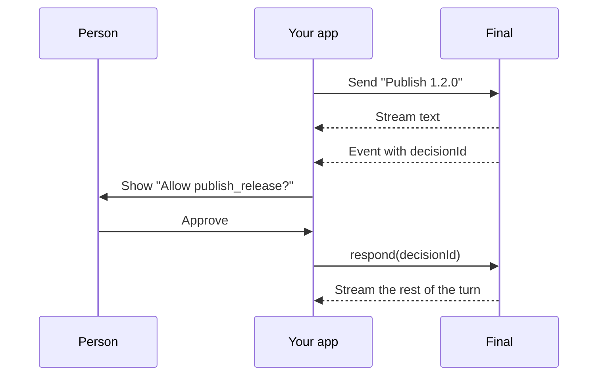

A session is one ongoing thread with one agent, like a single chat. You start it with the agent and a `provide` object, send it a message, and watch the work stream in: text as it's written, tool calls as they happen, and requests for a person when the agent needs one. Use sessions when your app owns the chat UI or runs the agent as a task. For chats stored in Final's apps, see [conversations](/client/conversations).

These examples use the release assistant from the [quickstart](/quickstart).

## Create a client

```ts server/final.ts
import { createClient } from '@finalai/agents/client';

export const client = createClient({
  auth: { apiKey: process.env.FINAL_API_KEY! },
  localCompute: false,
});
export const project = client.project({ id: process.env.FINAL_PROJECT_ID! });
```

`client.project({ id })` scopes everything you create, and a session can only be provided sandboxes and integrations from its own project.

<Warning>
Create the client on your server, never in browser code. Your [API key](/api-keys) can run every agent in its project. Browsers should call your backend, which calls Final.
</Warning>

`localCompute: false` keeps your server from lending its own machine to agents: a `files` or `shell` requirement you leave out fails instead of running in the server. Leave it on for scripts and tools you run on your own machine. See [where code and compute run](/build/where-code-runs).

## Send a message and wait for the answer

`project.sessions.create` starts a session and, when you pass `message`, its first turn. `response.result()` waits for the turn to finish:

```ts
import { finalCredits, serverlessFinal } from '@finalai/agents/harnesses';
import { agent } from './agent.js';
import { project } from './server/final.js';

const harness = serverlessFinal({ model: 'deepseek-v4.1-flash', inference: finalCredits() });

const { handle, response } = await project.sessions.create({
  agent,
  provide: { harness },
  message: 'Is 1.2.0 ready to ship?',
});

const result = await response!.result();
console.log(result.text);       // The agent's reply
console.log(result.stopReason); // Why the turn ended, like "end_turn"
```

Check `stopReason` even when `text` is empty. A turn that was cancelled or hit an error can end without any text.

If the agent's requirements aren't met, `create` throws a `requirements_unmet` error listing what's missing, and creates nothing. See [requirements and providing](/build/requirements#nothing-starts-with-something-missing).

### Options for creating a session

<ParamField path="agent" type="agent value | fetched agent" required>
  The value you defined, or one fetched with `project.agents.get({ name })`. Never a string.
</ParamField>

<ParamField path="provide" type="ProvideIface" required>
  What the agent requires: `harness`, `compute`, `integrations`.
</ParamField>

<ParamField path="id" type="string">
  A session ID you choose, such as `crypto.randomUUID()`. Use it to create things the session owns first, like a sandbox with `ownedBy: { session: id }`. Creating again with an ID that exists returns that session.
</ParamField>

<ParamField path="actor" type="{ externalId, displayName? }">
  Your app's end user the first turn acts for, so their personal sign-ins and subscriptions are theirs, not yours.
</ParamField>

<ParamField path="message" type="string | content blocks">
  The first message. Without it, the session waits for `handle.send`.
</ParamField>

<ParamField path="turnPolicy" type="'queue' | 'steer'">
  What a message sent during a running turn does. See [send follow-ups](#send-follow-ups).
</ParamField>

<ParamField path="idempotencyKey" type="string">
  Pass the same key when retrying a create that might have reached Final.
</ParamField>

<ParamField path="title" type="string">
  A title for the session.
</ParamField>

## Stream the reply as it's written

`response.stream()` yields the turn's events as they happen. Each event wraps one update from the agent. `sessionUpdateOf` unwraps it, and `textOf` pulls out the text:

```ts
import { sessionUpdateOf, textOf } from '@finalai/agents/client';

for await (const event of response!.stream()) {
  const update = sessionUpdateOf(event);
  if (update?.sessionUpdate === 'agent_message_chunk') {
    process.stdout.write(textOf(update));
  }
}
```

The loop ends when the turn ends. These are the updates you'll use most:

| `sessionUpdate` | What it means | Show it as |
| --- | --- | --- |
| `agent_message_chunk` | The next piece of the reply. | Append to the message bubble. |
| `agent_thought_chunk` | The model's reasoning, when it shares it. | A collapsible "thinking" block. |
| `tool_call` | The agent started a tool call. Includes a `title`. | A status line, like "Checking release status". |
| `tool_call_update` | A tool call's status or result changed. | Update or finish the status line. |
| `state_update` | The session's state changed. `idle` with a `stopReason` ends the turn. | Stop the typing indicator. |

### Stream to a browser

In a web app, your server reads the stream and forwards the text to the browser. This route handler works in any framework that uses Web `Request` and `Response`:

```ts app/api/chat/route.ts
import { sessionUpdateOf, textOf } from '@finalai/agents/client';
import { finalCredits, serverlessFinal } from '@finalai/agents/harnesses';
import { agent } from '../../../agent.js';
import { project } from '../../../server/final.js';

export async function POST(request: Request) {
  const { message } = await request.json();
  const { handle, response } = await project.sessions.create({
    agent,
    provide: {
      harness: serverlessFinal({ model: 'deepseek-v4.1-flash', inference: finalCredits() }),
    },
    message,
  });

  const encoder = new TextEncoder();
  const body = new ReadableStream({
    async start(controller) {
      for await (const event of response!.stream()) {
        const update = sessionUpdateOf(event);
        if (update?.sessionUpdate === 'agent_message_chunk') {
          controller.enqueue(encoder.encode(textOf(update)));
        }
      }
      controller.close();
    },
  });

  return new Response(body, {
    headers: { 'content-type': 'text/plain; charset=utf-8', 'x-session-id': handle.id },
  });
}
```

The browser reads the body as it arrives and keeps the session ID for follow-up messages. In your own app, keep the Workers sandbox ID in configuration rather than taking it from the request.

## Handle approvals

Some steps wait for a person: a tool with an [approval policy](/build/tools#ask-before-a-tool-runs), a shell command when the harness runs with `permissionMode: 'ask'`, or a first call to an integration the person hasn't signed in to. The turn pauses and Final creates a **decision**, a request waiting for an answer. The turn continues as soon as someone answers it.



In the stream, the event that pauses the turn has a `decisionId`. Load the decision to see what it's asking, show it to the person, and send their answer:

```ts
import { DecisionKind, type DecisionRecordIface } from '@finalai/agents/client';

for await (const event of response!.stream()) {
  // ...render text as above...

  if (event.decisionId != null) {
    const decision = (await handle.decisions()).find((d) => d.id === event.decisionId);
    if (decision != null) await answer(decision);
  }
}

async function answer(decision: DecisionRecordIface) {
  const { title, body, options } = decision.request;

  if (decision.kind === DecisionKind.Permission) {
    // A built-in action, like a shell command. Show one button per option.
    const picked = await showChoices(title, options.map((option) => option.name));
    await handle.respond({ decisionId: decision.id, optionId: options[picked]!.optionId });
  } else if (decision.kind === DecisionKind.Elicitation) {
    // A tool approval or a question from the agent. Show Approve and Decline.
    const approved = await showApproval(title, body);
    await handle.respond({
      decisionId: decision.id,
      outcome: { action: approved ? 'accept' : 'decline' },
    });
  }
}
```

`showChoices` and `showApproval` stand in for your UI. The kinds of decision are answered differently:

| `kind` | Raised by | Answer with |
| --- | --- | --- |
| `permission` | The harness's built-in shell and file actions. `request.options` lists choices like allow once, allow always, and reject, each with an `optionId` and a `name`. | `respond({ decisionId, optionId })` |
| `elicitation` | Your tools and integration tools that need approval, or a question from the agent. `request.body` has the message to show. | `respond({ decisionId, outcome: { action: 'accept' } })`, or `'decline'` |
| `sign_in` | Final, when a call needs the person's sign-in to an integration. `request.signIn` names the integration. | The person signs in; see [sign-in](/build/integrations#sign-in). |
| `bind` | An agent with Final's gateway asking for an optional requirement. `request.bind` says what and why. | The person picks something to provide. See [optional requirements](/build/requirements#optional-requirements). |

Final raises `sign_in` decisions itself rather than through an agent frame, so list `handle.decisions()` when a turn waits without a frame that has a `decisionId`.

In a web app, the person's click arrives in a different request from the stream. Save the decision ID with the session ID, and answer from that request's handler:

```ts
await client.sessions.attach(sessionId).respond({ decisionId, optionId });
```

## Send follow-ups

The session keeps its history, so a follow-up has the full context of the chat. Send it with `handle.send` and read it like the first turn:

```ts
const next = await handle.send('The release owner signed off. Can we ship now?');
console.log(await next.text());
```

If you send while a turn is still running, `turnPolicy` decides what happens. `queue` runs the new message after the current turn finishes. `steer` adds it to the running turn so the agent can change course, which suits "stop, use 1.2.1 instead." Pass it per message, like `handle.send(text, { turnPolicy: 'steer' })`, or for the whole session in `create`.

To give the agent context without asking for a reply, use `observe`. The text joins the history, and the agent sees it on its next turn:

```ts
await handle.observe('The release owner changed to Morgan.');
```

## Stop and clean up

- `handle.cancel()` stops the running turn. The turn ends with the stop reason `cancelled`.
- `handle.close()` ends the session. Do this when the chat or task is over, not after every turn.
- `client.close()` ends your client's open streams and local connections when your process shuts down. Sessions carry on without it.

Passing an `AbortSignal` to a call, like `response.stream({ signal })`, only stops your local request. The agent keeps working.

## Reconnect after a disconnect

A session lives on Final, not in your process, so you can pick it up again after a restart or a dropped connection. Save the session ID and the turn ID (`response.turnId`) when you start a turn, then reattach:

```ts
const session = client.sessions.attach(sessionId);
const response = await session.response(turnId);
console.log((await response.result()).text);
```

This doesn't resend the message. It returns the same turn, whether it's still running or already finished.

To replay a session's events, for example to rebuild a chat view, use `session.stream({ fromSeq })`. Every event has a `seq` number that increases through the session. Save the last `seq` you rendered and pass the next number as `fromSeq` to continue where you left off.

In-process tools and local compute need the process that created the session. After a restart, they report themselves unavailable until that agent is started again from a process that holds it; serverless tools keep working throughout.

## Inspect a session

| Call | Returns |
| --- | --- |
| `session.get()` | The session's state. |
| `session.requirements()` | Each of the agent's requirements and what provides it now. |
| `session.provide()` | The provide document the session was resolved with. |
| `session.manifest()` | The agent document the session pins and its provide document. |
| `session.decisions()` | The session's open decisions. |
| `session.setConfigOption({ configId, value })` | Changes an option the harness advertises, like the model or reasoning level. |
