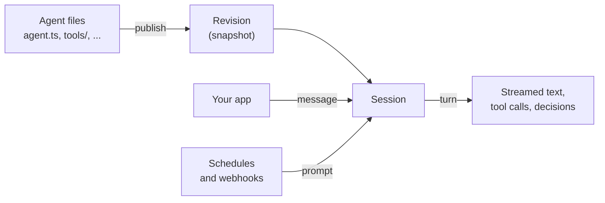

An agent on Final goes through the same path every time: you write it as files, publish a snapshot, and your app or a trigger starts sessions with it. Once you know the handful of objects along that path, the rest of the SDK follows.

## From files to a published agent

You write an agent as a directory of files. `agent.ts` names it and picks the harness, `instructions.md` says how it should behave, and folders like `tools/` and `schedules/` add capabilities. The compiler finds each file by its location, so there's no registry to keep in sync. See [project structure](/build/project-structure).

The **agent** itself is a record in your Final project with a name, a **slug** you call it by, and a Git repository that holds its source. You register it once.

When you publish, Final compiles the source into a **revision**: an immutable, numbered snapshot of the agent. The newest revision becomes current, and new sessions start on it. Sessions that are already running keep the revision they started with, so a deploy never changes an agent in the middle of a conversation. See [testing and publishing](/operate/publishing).

## The harness runs the agent loop

The **harness** is the program that actually runs your agent. It sends the conversation to the model, runs the tools the model asks for, feeds the results back, and repeats until the model has an answer. You pick a harness in `agent.ts`, for example `serverlessFinal`, which Final hosts for you.

The harness also needs **model credentials**: the account the model calls are made and billed with. You can use model access provided by Final, your organization's own provider API key, or a connected subscription. See [configuration](/build/configuration).

## Sessions, turns, and stop reasons

A **session** is one ongoing thread with one agent, like a single chat. It keeps the full history, so follow-up messages have context.

Each message you send starts a **turn**. During a turn the agent may think, call several tools, and write text, and you can watch all of it stream in as **events**. A turn ends with a **stop reason** such as `end_turn` (the agent finished) or `cancelled` (someone stopped it). Read the stop reason even when the reply text is empty, because it tells you why the turn ended. See [sessions and streaming](/client/sessions).

## Decisions pause a turn for a person

Some actions shouldn't happen without a person's OK, like publishing a release or running a shell command. When the agent reaches one, the turn pauses and Final records a **decision**: a request with the options a person can choose. Your app shows it, the person answers, and the turn continues. You choose which actions need approval when you define [tools](/build/tools#ask-before-a-tool-runs) and [connections](/build/connections).

## Capabilities: what the agent can do

| Capability | What it gives the agent |
| --- | --- |
| [Tools](/build/tools) | TypeScript functions you write, such as "look up release status." |
| [Connections](/build/connections) | Tools from an MCP server, such as your issue tracker or Final's connected accounts. |
| [Sandboxes](/build/sandboxes) | A cloud computer with a shell and files, for running code and editing repositories. |
| [Instructions and skills](/build/instructions-and-skills) | Standing guidance, plus step-by-step procedures the agent loads when it needs them. |

## Triggers: how work arrives

Most sessions start because your app sends a message. Two other triggers start work on their own:

- [Schedules](/build/schedules) send the agent a prompt on a cron schedule, like a daily digest.
- [Channels](/build/channels) turn an HTTP request, like a webhook from your deploy system, into a message for the agent.

[Hooks](/build/hooks) run your code when something happens in a session, such as a turn ending, without changing what the agent does.

## Sessions or conversations

Your app uses sessions to talk to an agent. People can also chat with agents in Final:

- **Sessions** are the direct line: you send a message and stream the agent's work. Use them for tasks, or when your app stores its own chat history.
- **[Conversations](/client/conversations)** are chats in Final's signed-in web and mobile apps, with people and agents as participants, message history, and read state. Final delivers each message to the right agent's session for you. Conversation management requires a signed-in person; project API keys use sessions instead.
