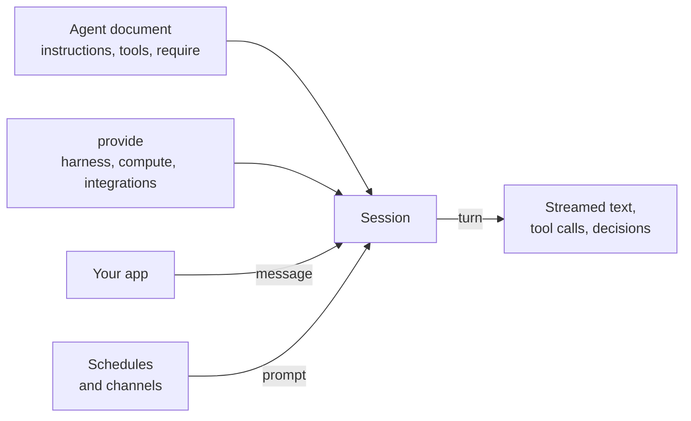

An agent on Final is data that says what it needs. Whoever starts it provides what it needs, and Final runs the orchestration in between. Once you know the handful of objects along that path, the rest of the SDK follows.

## An agent is a document

You define an agent with `defineAgent` in one module that lists every part explicitly: instructions, skills, tools, hooks, schedules, and its requirements. The SDK turns that value into the agent's **document**, plain JSON that includes each tool's name and schema and the source of each serverless tool. Final stores a document by its content hash, so the same agent always has the same identity. See [the agent module](/build/project-structure).

Nothing is built or deployed. Starting a session sends the document with the call. To let others fetch the agent, you **publish** it under a name, which points the name at a hash. See [publishing](/operate/publishing).

## Requirements and provide

An agent never names the things that run it. It states requirements instead:

| The agent requires | The caller provides |
| --- | --- |
| A harness, held to a permission ceiling | [Harness settings](/harnesses/settings): which harness, which model, how inference is paid for |
| Compute, by capability: `files`, `shell`, `computerUse`, `browserUse` | A [sandbox](/build/sandboxes) for each capability, such as a cloud computer or a Final Device |
| Integration slots, each with a description and a tool policy | An [integration](/build/integrations) for each slot: an MCP server and how it authenticates |

Every call that starts work takes a `provide` object. If something required is missing or unsuitable, the call fails with `requirements_unmet`, lists what's wrong, and creates nothing. A running agent therefore always has everything it requires. See [requirements and providing](/build/requirements).

## The harness runs the model loop

The **harness** is the program that sends the conversation to the model, runs the tools it asks for, and repeats until it has an answer. Final's harnesses include its own loop (`final`), Pi, nanocode engines for Claude and Codex models, and Claude Code and Codex themselves. Harness settings also carry **inference**: where model access comes from and who's charged, such as a person's own subscription, a project API key, or Final's metered inference. See [harness settings](/harnesses/settings) and [harnesses, adapters, and environments](/harnesses/overview).

## Where code and compute run

- **The model's files and shell** run on the sandbox provided for them. If the caller leaves them out, they run in the caller's own process, on its machine.
- **Serverless tools and hooks** are self-contained and run on Final's runtime, whether or not your process is running.
- **In-process tools and hooks** run in the process that created the session and can use anything that process holds, like a database connection.

See [where code and compute run](/build/where-code-runs).

## Sessions, turns, and stop reasons

A **session** is one ongoing thread with one agent. It pins one agent hash and keeps the full history, so follow-up messages have context.

Each message starts a **turn**. During a turn the agent may think, call tools, and write text, and you watch it stream in as **events**. A turn ends with a **stop reason** such as `end_turn` or `cancelled`. Read the stop reason even when the reply is empty. See [sessions and streaming](/client/sessions).

## Decisions pause a turn for a person

Some steps wait for a person: approving a tool call, answering a question, or signing in to an integration for the first time. Final records a **decision** with the options a person can choose; your app shows it, the person answers, and the turn continues. You choose which actions need approval when you define [tools](/build/tools#ask-before-a-tool-runs) and [integration slots](/build/integrations).

## Triggers: how work arrives

Most sessions start because your app sends a message. Two other triggers start work on their own:

- [Schedules](/build/schedules) send the agent a prompt on a cron schedule, with a `provide` set up once.
- [Channels](/build/channels) turn events from an outside surface, like a webhook or a chat app, into messages in Final's chats.

[Hooks](/build/hooks) run your code when something happens in a session, without changing what the agent does.

## Sessions or conversations

- **Sessions** are the direct line: you send a message and stream the agent's work. Use them for tasks, or when your app stores its own chat history.
- **[Conversations](/client/conversations)** are chats Final stores, with people and agents as participants, message history, and read state. Each agent participant has its own `provide`, and Final delivers each message to the right agent's session.
