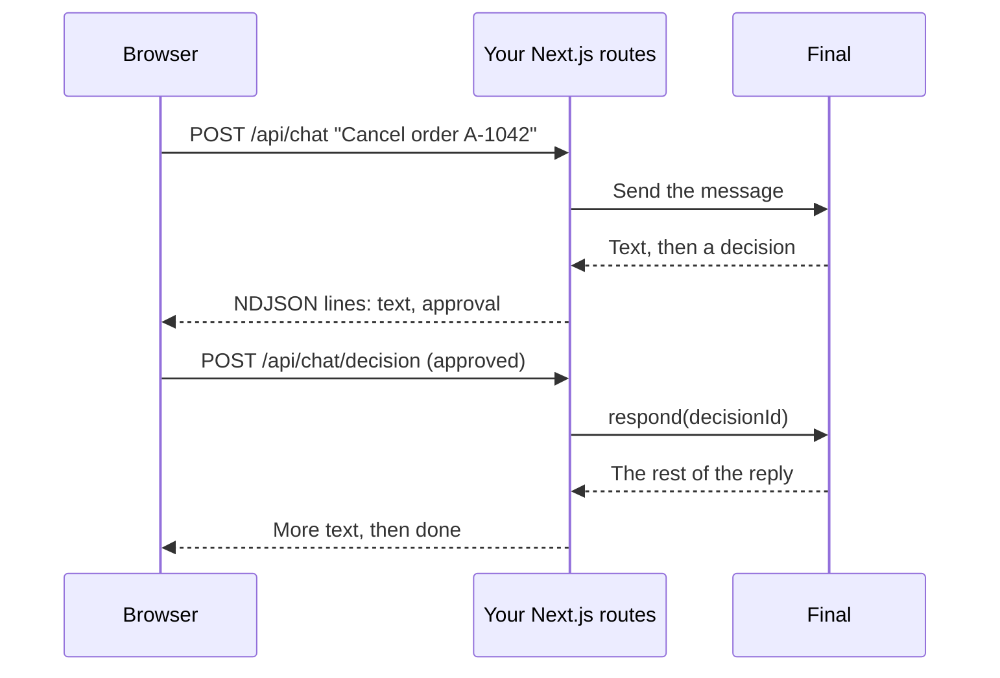

This example puts an order-support agent on your store's website. Customers ask about an order in a chat panel, the reply streams in as it's written, and when the agent wants to cancel an order, the customer gets **Approve** and **Decline** buttons. Use this pattern when the chat lives in your product's UI and your server talks to Final.

**What it shows:** a tool with an [approval](/build/tools#ask-before-a-tool-runs), [streaming](/client/sessions#stream-to-a-browser) a session from a Next.js route, forwarding [decisions](/client/sessions#handle-approvals) to the browser and answering them from a second route, and [follow-up messages](/client/sessions#send-follow-ups) in the same session.

## How it fits together



The browser never talks to Final directly, because your API key stays on the server.

## Files

<Tree>

- acme-store/
  - package.json
  - .gitignore
  - agent/
    - agent.ts
    - instructions.md
    - lib/
      - store-api.ts
    - tools/
      - lookup_order.ts
      - cancel_order.ts
  - server/
    - final.ts
  - app/
    - api/
      - chat/
        - route.ts
        - decision/
          - route.ts
    - support/
      - page.tsx

</Tree>

The `agent/` folder is what you publish. The rest is your Next.js app, and only `server/final.ts` and the two routes import the SDK.

## The agent

```ts agent/agent.ts
import { credentials, defineAgent } from '@finalai/agents';
import { serverlessFinal } from '@finalai/agents/harnesses';

export default defineAgent({
  name: 'Order Support',
  description: 'Answers questions about Acme Store orders and cancels them on request.',
  secrets: ['store-api-token'],
  harness: serverlessFinal({
    credentials: credentials.chain({
      payer: 'organization',
      tryInOrder: [credentials.platform()],
    }),
    permissionMode: 'ask',
  }),
});
```

```markdown agent/instructions.md
You're the order support assistant for Acme Store. You talk to customers, so be warm and brief.

To look up an order, you need its number (like A-1042) and the email it was placed with. Ask for whichever is missing.
Only discuss the order you looked up. Never guess at shipping dates or refund amounts; read them from lookup_order.
Orders can be canceled until they ship. Before you call cancel_order, tell the customer that they'll be asked to confirm.
If the customer asks for something you can't do from chat, like changing the address on a shipped order, say so plainly instead of promising it.
```

Both tools call your store's API through one helper. The API only returns an order when the number and email match, so a customer can't look up someone else's order by guessing numbers:

```ts agent/lib/store-api.ts
import type { ToolContextIface } from '@finalai/agents';

export async function storeApi<T>(ctx: ToolContextIface, path: string, init: RequestInit = {}) {
  const token = await ctx.secrets.get('store-api-token');
  if (!token) throw new Error('The store-api-token secret is not set');

  const response = await fetch(`https://api.acme-store.com/v1${path}`, {
    ...init,
    headers: { authorization: `Bearer ${token}`, 'content-type': 'application/json' },
    signal: ctx.abortSignal,
  });
  if (response.status === 404) return null;
  if (!response.ok) throw new Error(`Store API returned ${response.status}`);
  return (await response.json()) as T;
}
```

<CodeGroup>

```ts agent/tools/lookup_order.ts
import { defineTool } from '@finalai/agents';
import { z } from 'zod';
import { storeApi } from '../lib/store-api.js';

interface Order {
  number: string;
  status: 'processing' | 'shipped' | 'delivered' | 'canceled';
  items: { name: string; quantity: number }[];
  totalCents: number;
  estimatedDelivery: string | null;
  trackingUrl: string | null;
}

export default defineTool({
  description: 'Look up an order by its number and the email it was placed with.',
  inputSchema: z.object({
    orderNumber: z.string().regex(/^A-\d+$/).describe('Like A-1042'),
    email: z.email(),
  }),
  annotations: { readOnlyHint: true },
  label: { start: ({ orderNumber }) => `Looking up ${orderNumber}` },
  async execute({ orderNumber, email }, ctx) {
    const query = new URLSearchParams({ email });
    const order = await storeApi<Order>(ctx, `/orders/${orderNumber}?${query}`);
    return order ?? { found: false, message: 'No order matches that number and email.' };
  },
});
```

```ts agent/tools/cancel_order.ts
import { defineTool } from '@finalai/agents';
import { always } from '@finalai/agents/approval';
import { z } from 'zod';
import { storeApi } from '../lib/store-api.js';

export default defineTool({
  description: 'Cancel an order that has not shipped yet. The customer confirms first.',
  inputSchema: z.object({
    orderNumber: z.string().regex(/^A-\d+$/),
    email: z.email(),
  }),
  approval: always(),
  label: { start: ({ orderNumber }) => `Canceling ${orderNumber}` },
  async execute({ orderNumber, email }, ctx) {
    const result = await storeApi<{ refundCents: number }>(ctx, `/orders/${orderNumber}/cancel`, {
      method: 'POST',
      body: JSON.stringify({ email }),
    });
    if (!result) return { canceled: false, message: 'No order matches that number and email.' };
    return { canceled: true, refundCents: result.refundCents };
  },
});
```

</CodeGroup>

`label` sets the short status line a chat UI can show while the tool runs, like "Looking up A-1042".

## The server

The client lives in one server-only module:

```ts server/final.ts
import { createClient } from '@finalai/agents/client';

export const client = createClient({
  host: 'https://agent-session.final.ai/api',
  auth: { apiKey: process.env.FINAL_API_KEY! },
});
```

The chat route starts a session on the first message and sends follow-ups to the same session after that. It streams [NDJSON](https://github.com/ndjson/ndjson-spec), one JSON object per line, so the browser can tell text apart from approval requests:

```ts app/api/chat/route.ts
import { sessionUpdateOf, textOf } from '@finalai/agents/client';
import { client } from '@/server/final';

export type ChatEvent =
  | { type: 'session'; sessionId: string }
  | { type: 'text'; text: string }
  | { type: 'approval'; decisionId: string; title: string | null; body: string | null }
  | { type: 'done'; stopReason: string | null };

export async function POST(request: Request) {
  const { message, sessionId } = (await request.json()) as {
    message: string;
    sessionId: string | null;
  };

  // Continue the customer's chat, or start a new one.
  const session = sessionId
    ? client.sessions.attach(sessionId)
    : (await client.sessions.create({ agent: 'order-support' })).handle;
  const turn = await session.send(message);

  const encoder = new TextEncoder();
  const body = new ReadableStream({
    async start(controller) {
      const emit = (event: ChatEvent) =>
        controller.enqueue(encoder.encode(JSON.stringify(event) + '\n'));

      emit({ type: 'session', sessionId: session.id });
      const forwarded = new Set<string>();

      for await (const event of turn.stream({ signal: request.signal })) {
        const update = sessionUpdateOf(event);
        if (update?.sessionUpdate === 'agent_message_chunk') {
          emit({ type: 'text', text: textOf(update) });
        }

        // The turn is paused on an approval. Send it to the browser; the stream
        // stays open and continues once the customer answers.
        if (event.decisionId && !forwarded.has(event.decisionId)) {
          forwarded.add(event.decisionId);
          const decision = (await session.decisions()).find((d) => d.id === event.decisionId);
          if (decision) {
            const { title, body } = decision.request;
            emit({ type: 'approval', decisionId: decision.id, title, body });
          }
        }
      }

      emit({ type: 'done', stopReason: (await turn.result()).stopReason });
      controller.close();
    },
  });

  return new Response(body, { headers: { 'content-type': 'application/x-ndjson' } });
}
```

The customer's click arrives as a separate request. This agent has no shell or file tools, so every decision is a tool approval, answered with `accept` or `decline`:

```ts app/api/chat/decision/route.ts
import { client } from '@/server/final';

export async function POST(request: Request) {
  const { sessionId, decisionId, approved } = (await request.json()) as {
    sessionId: string;
    decisionId: string;
    approved: boolean;
  };

  await client.sessions.attach(sessionId).respond({
    decisionId,
    outcome: { action: approved ? 'accept' : 'decline' },
  });
  return new Response(null, { status: 204 });
}
```

<Warning>
These routes trust whatever session ID the browser sends. In production, store each session ID with the visitor's own session or account when the chat starts, and check that the ID belongs to them before you attach to it or answer a decision.
</Warning>

## The page

The page posts each message, reads the NDJSON stream line by line, and shows buttons when an approval arrives:

```tsx app/support/page.tsx
'use client';

import { useState } from 'react';
import type { ChatEvent } from '../api/chat/route';

type Approval = Extract<ChatEvent, { type: 'approval' }>;
type Message = { from: 'you' | 'agent'; text: string };

export default function SupportPage() {
  const [messages, setMessages] = useState<Message[]>([]);
  const [sessionId, setSessionId] = useState<string | null>(null);
  const [approval, setApproval] = useState<Approval | null>(null);
  const [draft, setDraft] = useState('');
  const [busy, setBusy] = useState(false);

  function apply(event: ChatEvent) {
    if (event.type === 'session') setSessionId(event.sessionId);
    if (event.type === 'approval') setApproval(event);
    if (event.type === 'text') {
      setMessages((all) => {
        const last = all[all.length - 1];
        return [...all.slice(0, -1), { ...last, text: last.text + event.text }];
      });
    }
  }

  async function send(text: string) {
    setDraft('');
    setBusy(true);
    setMessages((all) => [...all, { from: 'you', text }, { from: 'agent', text: '' }]);

    const response = await fetch('/api/chat', {
      method: 'POST',
      headers: { 'content-type': 'application/json' },
      body: JSON.stringify({ message: text, sessionId }),
    });
    const reader = response.body!.pipeThrough(new TextDecoderStream()).getReader();
    let buffer = '';
    for (;;) {
      const { done, value } = await reader.read();
      if (done) break;
      buffer += value;
      const lines = buffer.split('\n');
      buffer = lines.pop()!;
      for (const line of lines) if (line) apply(JSON.parse(line) as ChatEvent);
    }
    setBusy(false);
  }

  async function answer(approved: boolean) {
    if (!approval || !sessionId) return;
    setApproval(null);
    await fetch('/api/chat/decision', {
      method: 'POST',
      headers: { 'content-type': 'application/json' },
      body: JSON.stringify({ sessionId, decisionId: approval.decisionId, approved }),
    });
  }

  return (
    <main>
      {messages.map((message, i) => (
        <p key={i} className={message.from}>
          {message.text}
        </p>
      ))}

      {approval && (
        <div role="dialog">
          <p>{approval.body ?? approval.title}</p>
          <button onClick={() => answer(true)}>Approve</button>
          <button onClick={() => answer(false)}>Decline</button>
        </div>
      )}

      <form
        onSubmit={(event) => {
          event.preventDefault();
          if (draft.trim()) send(draft.trim());
        }}
      >
        <input value={draft} onChange={(event) => setDraft(event.target.value)} disabled={busy} />
        <button disabled={busy}>Send</button>
      </form>
    </main>
  );
}
```

## Build and publish it

<Steps>
  <Step title="Add the SDK to your app">
    In your Next.js project, install the SDK and make sure `.final/` is ignored:

    ```bash
    npm install @finalai/agents zod
    printf '.final/\n' >> .gitignore
    ```
  </Step>
  <Step title="Add the store token">
    In the Final dashboard, add your store API's token under **Developer** > **Secrets** with the name `store-api-token`. Put your Final API key in `.env.local` as `FINAL_API_KEY` so the routes can read it.
  </Step>
  <Step title="Compile it">
    ```bash
    npx final-agents build ./agent
    ```

    ```text
    agent: Order Support
    description: Answers questions about Acme Store orders and cancels them on request.
    harness: package:@finalai/final-agent-provider/harnesses/serverless-final
    mcp servers: authored (worker)
    ...
    secrets: store-api-token
    ...
    wrote agent/.final/compile
    ```
  </Step>
  <Step title="Register and publish it">
    Register the `order-support` slug once in the same project as your key and secret, following the [quickstart](/quickstart#register-the-agent) with that slug and the name **Order Support**. This agent declares a secret, so publication requires an organization admin with project edit access.

    Save the [`upload-draft.ts` script](/operate/publishing#publish-code-that-uses-secrets) beside `agent/`, then upload the initial default-branch draft with your project API key:

    ```bash
    node upload-draft.ts order-support agent.ts instructions.md lib/store-api.ts tools/lookup_order.ts tools/cancel_order.ts
    ```

    Resolve any reported compile errors or missing secrets. Have that admin review the uploaded files in the agent's **Code** view in Final and choose **Save and publish**. Uploading or compiling does not publish it. After publication, later source edits also use that admin's Code view; the API key cannot make those updates through CI.
  </Step>
</Steps>

## Try it

Start your app with `npm run dev`, open `http://localhost:3000/support`, and send _"Please cancel order A-1042. My email is jordan@example.com."_

The agent looks up the order, tells you it will ask you to confirm, and the **Approve** and **Decline** buttons appear. Click **Approve**, and the reply continues in the same message:

```text
I found order A-1042: one Trail Runner backpack, $89.00, still processing.
I'll cancel it now. You'll be asked to confirm.

Done. Order A-1042 is canceled, and $89.00 will be back on your card in 5 to 10 business days.
```

Click **Decline** instead, and the agent tells you the order is unchanged.

## Make it yours

- **Show tool progress.** Forward `tool_call` updates as another NDJSON line type and render their `title`, which comes from each tool's `label`. See the [update types](/client/sessions) a stream can contain.
- **Survive page reloads.** Save the session ID in the visitor's session and replay earlier messages with `session.stream({ fromSeq })`, as described in [reconnect after a disconnect](/client/sessions#reconnect-after-a-disconnect).
