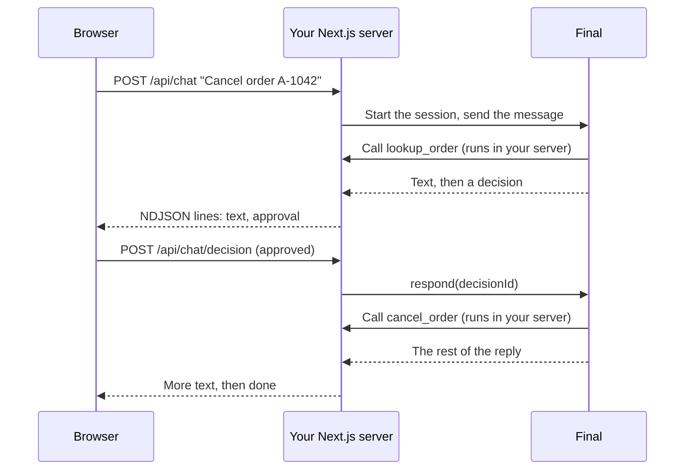

This example puts an order-support agent on your store's website. Customers ask about an order in a chat panel, the reply streams in as it's written, and when the agent wants to cancel an order, the customer gets **Approve** and **Decline** buttons. The agent's tools read and change orders through your app's own data layer, so they run inside your server. Use this pattern when the chat lives in your product's UI and your server talks to Final.

**What it shows:** [in-process tools](/build/tools#in-process-or-serverless) that use your app's own data, a tool with an [approval](/build/tools#ask-before-a-tool-runs), [streaming](/client/sessions) a session from a Next.js route, forwarding [decisions](/client/sessions#handle-approvals) to the browser and answering them from a second route, and follow-up messages in the same session.

## How it fits together



The browser never talks to Final directly, because your API key stays on the server. Final calls the in-process tools back over the connection your server's client opened when it started the session.

## Files

<Tree>

- acme-store/
  - package.json
  - agent/
    - agent.ts
    - instructions.md
  - server/
    - final.ts
    - orders.ts
  - app/
    - api/
      - chat/
        - route.ts
        - decision/
          - route.ts
    - support/
      - page.tsx

</Tree>

`agent/` holds the agent. `server/orders.ts` is your store's data layer, and the rest is your Next.js app.

## The agent

```markdown agent/instructions.md
You're the order support assistant for Acme Store. You talk to customers, so be warm and brief.

To look up an order, you need its number (like A-1042) and the email it was placed with. Ask for whichever is missing.
Only discuss the order you looked up. Never guess at shipping dates or refund amounts; read them from lookup_order.
Orders can be canceled until they ship. Before you call cancel_order, tell the customer that they'll be asked to confirm.
If the customer asks for something you can't do from chat, like changing the address on a shipped order, say so plainly instead of promising it.
```

Both tools are defined with `defineInProcessTool`, so they can import `orders` from your app and use it directly. Their code never leaves your server: the agent's document carries only each tool's name, description, and input schema. Both check that the order number and email match, so a customer can't look up someone else's order by guessing numbers.

```ts agent/agent.ts
import { defineAgent, defineInProcessTool, markdown } from '@finalai/agents';
import { always } from '@finalai/agents/approval';
import * as z from 'zod';
import { orders } from '../server/orders.js';

// In-process tools: they use the store's own data layer, so they run in the
// server process that creates the session. Their code never leaves it.
const lookupOrder = defineInProcessTool({
  description: 'Look up an order by its number and the email it was placed with.',
  inputSchema: z.object({
    orderNumber: z.string().regex(/^A-\d+$/).describe('Like A-1042'),
    email: z.email(),
  }),
  annotations: { readOnlyHint: true },
  execute: async ({ orderNumber, email }) => {
    const order = await orders.find(orderNumber, email);
    if (order == null) return { found: false, message: 'No order matches that number and email.' };
    const { email: _email, ...visible } = order;
    return { found: true, ...visible };
  },
});

const cancelOrder = defineInProcessTool({
  description: 'Cancel an order that has not shipped yet. The customer confirms first.',
  inputSchema: z.object({
    orderNumber: z.string().regex(/^A-\d+$/),
    email: z.email(),
  }),
  approval: always(),
  execute: async ({ orderNumber, email }) => {
    const order = await orders.find(orderNumber, email);
    if (order == null) return { canceled: false, message: 'No order matches that number and email.' };
    if (order.status !== 'processing') return { canceled: false, message: `The order is ${order.status}.` };
    const { refundCents } = await orders.cancel(orderNumber);
    return { canceled: true, refundCents };
  },
});

export const agent = defineAgent({
  name: 'Order Support',
  description: 'Answers questions about Acme Store orders and cancels them on request.',
  instructions: markdown('./instructions.md', { from: import.meta.url }),
  tools: { lookup_order: lookupOrder, cancel_order: cancelOrder },
  require: {
    harness: { permissionMode: 'ask' },
  },
});
```

`server/orders.ts` stands in for your real data access, such as a database client or an internal service:

```ts server/orders.ts expandable
// Stands in for your store's own data layer: a database client, an ORM, an internal service.
export interface OrderIface {
  number: string;
  email: string;
  status: 'processing' | 'shipped' | 'delivered' | 'canceled';
  items: { name: string; quantity: number }[];
  totalCents: number;
  estimatedDelivery: string | null;
}

const rows = new Map<string, OrderIface>([
  [
    'A-1042',
    {
      number: 'A-1042',
      email: 'jordan@example.com',
      status: 'processing',
      items: [{ name: 'Trail Runner backpack', quantity: 1 }],
      totalCents: 8900,
      estimatedDelivery: null,
    },
  ],
]);

export const orders = {
  // Returns an order only when the number and email match.
  find: async (number: string, email: string): Promise<OrderIface | null> => {
    const order = rows.get(number);
    return order != null && order.email === email ? order : null;
  },
  cancel: async (number: string): Promise<{ refundCents: number }> => {
    const order = rows.get(number);
    if (order == null || order.status !== 'processing') throw new Error(`${number} cannot be canceled`);
    order.status = 'canceled';
    return { refundCents: order.totalCents };
  },
};
```

## The server

The client lives in one server-only module. It's created with `localCompute: false`: this agent requires no files or shell, and a server should never offer the model its own machine for them if a later agent does. In-process tools are unaffected by that option.

```ts server/final.ts
import { createClient } from '@finalai/agents/client';
import { finalCredits, serverlessFinal } from '@finalai/agents/harnesses';
import { workers } from '@finalai/agents/sandboxes';

const apiKey = process.env.FINAL_API_KEY;
const projectId = process.env.FINAL_PROJECT_ID;
if (apiKey == null || projectId == null) throw new Error('Set FINAL_API_KEY and FINAL_PROJECT_ID');

// A server never lends its own machine to an agent: an omitted capability fails instead.
export const client = createClient({ auth: { apiKey }, localCompute: false });
export const project = client.project({ id: projectId });

let runtimeId: Promise<string> | null = null;

// The harness settings every chat uses. The Workers runtime is created once.
export const harness = async () => {
  runtimeId ??= project.sandboxes
    .create(workers(), { idempotencyKey: 'workers' })
    .then((runtime) => runtime.id);
  return serverlessFinal({
    model: 'deepseek-v4.1-flash',
    inference: finalCredits(),
    environment: await runtimeId,
  });
};
```

The chat route starts a session on the first message and sends follow-ups to the same session after that. Because this server process created the session from the `agent` value it imported, this process holds the in-process tools' code and Final calls them here. The route streams [NDJSON](https://github.com/ndjson/ndjson-spec), one JSON object per line, so the browser can tell text apart from approval requests:

```ts app/api/chat/route.ts
import { sessionUpdateOf, textOf } from '@finalai/agents/client';
import { agent } from '@/agent/agent';
import { client, harness, project } from '@/server/final';

export type ChatEvent =
  | { type: 'session'; sessionId: string }
  | { type: 'text'; text: string }
  | { type: 'approval'; decisionId: string; title: string | null; body: string | null }
  | { type: 'done'; stopReason: string | null };

export async function POST(request: Request) {
  const { message, sessionId } = (await request.json()) as {
    message: string;
    sessionId: string | null;
  };

  // Continue the customer's chat, or start a new one. Starting it here is what
  // makes this server process the one that answers the in-process tools.
  const session =
    sessionId != null
      ? client.sessions.attach(sessionId)
      : (await project.sessions.create({ agent, provide: { harness: await harness() } })).handle;
  const turn = await session.send(message);

  const encoder = new TextEncoder();
  const body = new ReadableStream({
    async start(controller) {
      const emit = (event: ChatEvent) =>
        controller.enqueue(encoder.encode(JSON.stringify(event) + '\n'));

      emit({ type: 'session', sessionId: session.id });
      const forwarded = new Set<string>();

      for await (const event of turn.stream({ signal: request.signal })) {
        const update = sessionUpdateOf(event);
        if (update?.sessionUpdate === 'agent_message_chunk') {
          emit({ type: 'text', text: textOf(update) });
        }

        // The turn is paused on an approval. Send it to the browser; the stream
        // stays open and continues once the customer answers.
        if (event.decisionId != null && !forwarded.has(event.decisionId)) {
          forwarded.add(event.decisionId);
          const decision = (await session.decisions()).find((d) => d.id === event.decisionId);
          if (decision != null) {
            const { title, body } = decision.request;
            emit({ type: 'approval', decisionId: decision.id, title, body });
          }
        }
      }

      emit({ type: 'done', stopReason: (await turn.result()).stopReason });
      controller.close();
    },
  });

  return new Response(body, { headers: { 'content-type': 'application/x-ndjson' } });
}
```

The customer's click arrives as a separate request. This agent has no shell or file tools, so every decision is a tool approval, answered with `accept` or `decline`:

```ts app/api/chat/decision/route.ts
import { client } from '@/server/final';

export async function POST(request: Request) {
  const { sessionId, decisionId, approved } = (await request.json()) as {
    sessionId: string;
    decisionId: string;
    approved: boolean;
  };

  await client.sessions.attach(sessionId).respond({
    decisionId,
    outcome: { action: approved ? 'accept' : 'decline' },
  });
  return new Response(null, { status: 204 });
}
```

<Warning>
These routes trust whatever session ID the browser sends. In production, store each session ID with the visitor's own session or account when the chat starts, and check that the ID belongs to them before you attach to it or answer a decision.
</Warning>

### Where in-process tools run

In-process tools answer only while the process that created the session is running and holds the agent value:

- **Run a long-lived Node.js server**, such as `next start` or a container. A serverless function that freezes between requests can't answer tool calls that arrive after its response is sent.
- **With several instances**, each session's tools run in the instance that created it, whichever instance handles the follow-up request.
- **After a restart or deploy**, sessions carry on, but the tools of sessions started by the old process report themselves unavailable, and the agent says it can't look up the order. Start a new session for the next chat.

If your tools only call an HTTP API, make them [serverless](/build/tools#in-process-or-serverless) instead: they run on Final and keep working no matter which process is up. See [where code runs](/build/where-code-runs).

## The page

The page posts each message, reads the NDJSON stream line by line, and shows buttons when an approval arrives:

```tsx app/support/page.tsx
'use client';

import { useState } from 'react';
import type { ChatEvent } from '../api/chat/route';

type Approval = Extract<ChatEvent, { type: 'approval' }>;
type Message = { from: 'you' | 'agent'; text: string };

export default function SupportPage() {
  const [messages, setMessages] = useState<Message[]>([]);
  const [sessionId, setSessionId] = useState<string | null>(null);
  const [approval, setApproval] = useState<Approval | null>(null);
  const [draft, setDraft] = useState('');
  const [busy, setBusy] = useState(false);

  function apply(event: ChatEvent) {
    if (event.type === 'session') setSessionId(event.sessionId);
    if (event.type === 'approval') setApproval(event);
    if (event.type === 'text') {
      setMessages((all) => {
        const last = all[all.length - 1];
        return [...all.slice(0, -1), { ...last, text: last.text + event.text }];
      });
    }
  }

  async function send(text: string) {
    setDraft('');
    setBusy(true);
    setMessages((all) => [...all, { from: 'you', text }, { from: 'agent', text: '' }]);

    const response = await fetch('/api/chat', {
      method: 'POST',
      headers: { 'content-type': 'application/json' },
      body: JSON.stringify({ message: text, sessionId }),
    });
    const reader = response.body!.pipeThrough(new TextDecoderStream()).getReader();
    let buffer = '';
    for (;;) {
      const { done, value } = await reader.read();
      if (done) break;
      buffer += value;
      const lines = buffer.split('\n');
      buffer = lines.pop()!;
      for (const line of lines) if (line) apply(JSON.parse(line) as ChatEvent);
    }
    setBusy(false);
  }

  async function answer(approved: boolean) {
    if (!approval || !sessionId) return;
    setApproval(null);
    await fetch('/api/chat/decision', {
      method: 'POST',
      headers: { 'content-type': 'application/json' },
      body: JSON.stringify({ sessionId, decisionId: approval.decisionId, approved }),
    });
  }

  return (
    <main>
      {messages.map((message, i) => (
        <p key={i} className={message.from}>
          {message.text}
        </p>
      ))}

      {approval && (
        <div role="dialog">
          <p>{approval.body ?? approval.title}</p>
          <button onClick={() => answer(true)}>Approve</button>
          <button onClick={() => answer(false)}>Decline</button>
        </div>
      )}

      <form
        onSubmit={(event) => {
          event.preventDefault();
          if (draft.trim()) send(draft.trim());
        }}
      >
        <input value={draft} onChange={(event) => setDraft(event.target.value)} disabled={busy} />
        <button disabled={busy}>Send</button>
      </form>
    </main>
  );
}
```

## Set it up

<Steps>
  <Step title="Add the SDK to your app">
    In your Next.js project, install the SDK:

    ```bash
    npm install @finalai/agents zod
    ```
  </Step>
  <Step title="Add your Final credentials">
    Put your Final API key and project ID in `.env.local` as `FINAL_API_KEY` and `FINAL_PROJECT_ID`, so the server can read them. The agent declares no secrets: its tools use your app's own data layer and credentials.
  </Step>
  <Step title="Check the document">
    ```bash
    npm install --save-dev tsx
    NODE_OPTIONS='--import tsx' npx final-agents print ./agent/agent.ts
    ```

    The agent module imports your TypeScript data layer, so the CLI loads it through tsx.

    Both tools appear with `"placement": "in-process"` and no source. That's expected: their code stays in your server.
  </Step>
</Steps>

Nothing needs to be published. The chat route sends the agent's document when it starts each session.

## Try it

Start your app with `npm run dev`, open `http://localhost:3000/support`, and send _"Please cancel order A-1042. My email is jordan@example.com."_

The agent looks up the order in your server, tells you it will ask you to confirm, and the **Approve** and **Decline** buttons appear. Click **Approve**, and the reply continues in the same message. The exact wording varies:

```text
I found order A-1042: one Trail Runner backpack, $89.00, still processing.
I'll cancel it now. You'll be asked to confirm.

Done. Order A-1042 is canceled, and $89.00 will be back on your card in 5 to 10 business days.
```

Click **Decline** instead, and the agent tells you the order is unchanged.

## Make it yours

- **Show tool progress.** Forward `tool_call` updates as another NDJSON line type and render their `title`. See the [update types](/client/sessions) a stream can contain.
- **Survive page reloads.** Save the session ID in the visitor's session and replay earlier messages with `session.stream({ fromSeq })`. See [sessions](/client/sessions).
- **Let people outside your app use it.** An agent with in-process tools can only be started by a process that holds its code. To publish it for chats in Final, rewrite the tools as [serverless](/build/tools#in-process-or-serverless) calls to your store's API. See [publishing](/operate/publishing).
