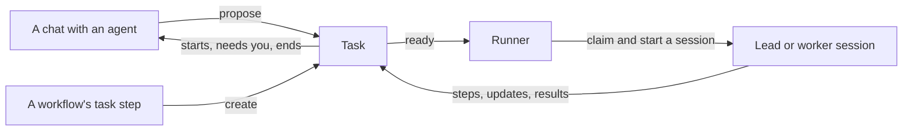

A project holds Tasks the same way it holds chats, agents, and sandboxes. A Task is a unit of work someone asked for: a brief, a thread of meaningful updates, and the results it delivers. The project's **Tasks** page lists them, and the API reads and changes the same Tasks.

The agents that work a Task do so in their own sessions, outside any chat. Each session's transcript is the detailed record of the work, linked from the Task. The Task's thread carries only what matters: progress, findings, questions, and results.



## Direct and team Tasks

A Task someone asks for is a **root** Task. It's worked one of two ways, chosen when it's proposed:

| Shape | Who works it |
| --- | --- |
| **Direct** ("1 agent") | One agent does the work itself. A specialist agent often proposes itself. |
| **Team** ("Team led by...") | A **lead** plans the work into **steps** and has other agents do them. It never does the work itself. |

"Lead" is a role, not a kind of agent. Whichever agent a team Task is assigned to leads it: by default the project's Project Agent, but any agent can lead, such as a security specialist. Final's [task tools](/tasks/agent-tools) tell each agent how to behave in its role, so any agent with those tools can lead, work a step, or review.

A Task's **brief** is markdown with Outcome, Purpose, Out of scope, Ask first, and Never sections; the last two bind every agent that works on it. Its **checklist** tracks what's done, in progress, or blocked, and its lead keeps it current.

A Task carries the agent that works it and the part of [`provide`](/build/requirements) it sets, in `sessions.create`'s shape, usually the harness and model. There is no default model: whoever runs the Task fills in only what the Task leaves out. See [run Tasks](/tasks/runners).

## States

| State | Meaning |
| --- | --- |
| `proposed` | Waiting for its person to accept it. |
| `waiting` | A step whose `needs` aren't all completed yet. |
| `ready` | Can be claimed by a runner. |
| `claimed` | A runner or an agent holds it and is working on it. |
| `completed` | Done. |
| `failed` | Given up on, with a reason. Can be reopened. |
| `canceled` | Stopped by a person or its lead. Can be reopened. |

A claimed Task can also be **held**, waiting on a question or an approval; see [holds](#holds). Read states tolerantly: an SDK older than the server reads a new state as unrecognized.

- Canceling a root cancels its open steps and stops the agents working them.
- A step that fails or is canceled leaves the steps that need it `waiting`, and its lead decides: reopen it, replace it, or cancel the rest.
- A root completes only once every one of its steps is completed, failed, or canceled.

## Proposals and approvals

Work starts only with a person's say-so. Every approval is a [decision](/client/decisions) in the Task's thread, listed under **Needs you**, and answered only by the person the Task acts for.

1. **Accept the proposal.** An agent in a chat proposes a Task with `propose_task`, or your code with `project.tasks.propose(...)`. The card shows the brief, who works it, and whether its result needs review. The person accepts, declines, or keeps it as a proposal; teammates can comment but not accept.
2. **Approve the plan** (team Tasks only). The lead posts its plan and waits for approval before creating any step. A plan of one step skips this approval.
3. **Accept the result** (when review is required). The agent posts its result for review. The person accepts it, or tells the agent what to change and gets a new revision.

**Review is chosen at proposal**, as `review: 'required'` or `'none'`:

- Anything with side effects, like code changes, messages, deploys, or purchases, is `required`. The Task completes only once its latest result is accepted, so it costs two approvals: the proposal and the result.
- Read-only work, like research, summaries, and answers, may be `none`. It completes on its own after the one approval of its proposal.

The agent makes this choice and shows it on the card. It's guidance in the agent's instructions, not a fixed classifier.

A result asked for review carries an **accept label** naming the action accepting it authorizes, like "Merge the pull request". Accepting authorizes exactly that action, which the agent then performs before it completes the Task.

Changing a Task's brief also needs approval: the lead proposes a new brief, and approving applies it. The person the Task acts for, and project admins, can edit the brief directly.

A [workflow's task step](/workflows/steps#hand-work-to-a-task) creates its Task `ready`, without a proposal: the published workflow is the approval.

## Steps and needs

A lead plans with `create_tasks`: up to 15 steps at once, each with a `key`, a brief, the agent and harness that works it, and `needs`, the keys of steps that must complete first. A step with open needs is `waiting` and becomes `ready` when every need has completed. A **list map** creates one step per input from a single template, up to 500, for wide fan-out.

Steps carry `labels`, which runners and reviewers match on. Two are conventions the task tools use:

- `role=reviewer`: a review step, which needs the steps it reviews.
- `role=judge`: a step that picks between several attempts.

Steps are one level deep: a step has no steps of its own. A step's `workspace` says which machine it works on; see [sandboxes for Tasks](/build/sandboxes#sandboxes-for-tasks).

Common shapes the lead's guidance follows:

| Pattern | Shape |
| --- | --- |
| Decompose | Steps, then an integrate step, then a review step. |
| Map | One template over many inputs, then an aggregate step that needs all of them. |
| Best of N | N attempts in `fork` workspaces, then a judge step. |
| Clarify first | The lead's first move is a question for the person. |

## Results

A result is an update in the Task's thread with **artifacts**:

| Kind | What it is |
| --- | --- |
| `file` | An uploaded file. |
| `document` | A document, by URL or attachment. |
| `link` | A URL, such as a pull request or a pushed branch. |
| `record` | Structured data that follows a result schema. |

A result names its **deliverable**. A later result for the same deliverable supersedes an earlier one still waiting for review, and the Task's **Results** show the latest revision of each. A result's state is `awaiting`, `superseded`, `changes_requested`, `accepted`, or `withdrawn`.

A step completes only on something that lasts: a link, a record, or a file or document. Review and judge steps complete on their verdict. The lead gathers its steps' artifacts and records into the root's result.

### Result schemas

A record names its schema as `name@version`. A Task with a `resultSchema` accepts only records of that schema. Final has three built in:

| Schema | Required fields | Other fields |
| --- | --- | --- |
| `pull-request@1` | `url` | `repository`, `number`, `branch`, `state` |
| `finding@1` | `title`, `severity` (`info`, `low`, `medium`, `high`, `critical`) | `location`, `description`, `evidence` |
| `source@1` | `url` | `title`, `quote`, `retrievedAt` |

A record that doesn't match its schema is refused.

## Holds

An agent that can't go on without an answer **holds** its Task. A held Task keeps its claim and its session, which waits without running.

| Hold | Raised by | Answered by |
| --- | --- | --- |
| `needs_input` | A worker or lead with a question. | On a team Task, a worker's question goes to its lead, who answers in the thread. A lead's question, or one on a direct Task, goes to the person. |
| `awaiting_approval` | An agent before an irreversible step, a lead with a plan or a brief change. | The person. |
| `review` | An agent asking for its result to be accepted. | The person. |
| `requirement` | A runner, before it can start a session that needs a sign-in or billing. | The person. Then the Task is ready again. |

The answer reaches the agent as input, and it carries on. A Task's decisions outlast its sessions: if a held session fails, the hold stays, and the agent that picks the Task up again gets the answer.

## Budgets, caps, and retries

- **Budget.** A root's `budgetUsd` caps what it spends on models and sandboxes, across its lead and every step. Once it's spent, claims are refused and the person is asked to raise it.
- **Project cap.** A project runs at most `maxRunning` claims at once, 4 by default. Set it with `project.tasks.settings.update({ maxRunning })`, or under **AI team** > **Tasks** in the project's settings. A root's own `maxRunning` caps its steps.
- **What counts.** Every claim being started or worked, except held ones and a team root's lead. A Task resumed from a hold doesn't wait for a free slot, so a project can briefly run over its cap.
- **Exclusive work.** Steps that share an `exclusiveKey` never run at the same time, for work that can't share ports or services.
- **Retries.** A session that fails releases its claim, and the Task is ready again. After three failures without progress, the Task fails. An agent whose turn ends without an update, a hold, or an outcome is nudged; after three nudges, the Task fails.

## Follow a Task

**Subscriptions** are per person: following or muted. Proposing, accepting, being mentioned, and replying subscribe you, and you can follow or mute any Task yourself (`subscribe`, `mute`, `unsubscribe`). They decide your notifications and the **Following** filter of the project's feed.

**Watches** are per chat. A chat that watches a Task has its agent hear when the Task starts, needs its person, and ends, so the agent can tell people in its own words. The chat that proposed a Task watches it automatically. Agents call `watch_task`; your code calls `project.tasks.watch({ taskId, conversationId })`.

Final's apps also prompt the person's Home when a Task they own completes, fails, is canceled, or needs them.

## Who can do what

A Task acts for one person, its **acting user**: usually whoever accepted it. Every agent working on it acts for that person, with their credentials and their spending. A teammate's reply reaches the agent as quoted information, labelled with its author, never as instructions, and it never changes whose authority the work runs with.

| Who | May |
| --- | --- |
| The acting user, project admins | Accept or decline, cancel, reopen, rename, archive, edit the brief, transfer the Task to another person, set the budget. Only the acting user answers its approvals. |
| The root's holder (the lead, or the agent on a direct Task) | Create steps, answer workers' questions, update the checklist, propose brief changes, request review, complete or fail the root, cancel or reopen steps. |
| A step's holder | Post updates, hold, request review, complete or fail its own step. |
| The claimer (a runner, or an external claimer) | Claim, renew, release, bind a session, raise requirement holds. An external claimer also posts and completes. |
| Project editors | Propose, reply, mention people, react. |
| Project viewers | Read every Task, its sessions' transcripts, its sandboxes (read-only), and the feed. |

API keys need the `tasks:read`, `tasks:write`, or `tasks:claim` permission. See [API keys](/api-keys#choose-permissions).

## Use Tasks from your code

`project.tasks` proposes, reads, and acts on a project's Tasks:

```ts
import { createClient } from '@finalai/agents/client';
import { finalCredits, serverlessPi } from '@finalai/agents/harnesses';

const client = createClient({ auth: { bearer: getToken } });
const project = client.project({ id: 'prj_your_project' });
const harness = serverlessPi({ model: 'gpt-6.1-sol', inference: finalCredits() });

const task = await project.tasks.propose({
  title: 'Add rate limiting to the public API',
  brief: [
    '## Outcome',
    'Requests over 100 per minute per key get 429 with Retry-After.',
    '## Out of scope',
    'Changing existing quotas.',
    '## Ask first',
    'Before adding a dependency.',
  ].join('\n'),
  role: 'team',
  review: 'required',
  agent: { name: 'release-lead' },
  provide: { harness },
});

const { tasks } = await project.tasks.list({ rootsOnly: true, states: ['claimed'] });
const { updates } = await project.tasks.updates({ taskId: task.id });
```

`feed` reads root-level updates across a project and the projects below it, for a Home-style feed. `project.tasks.sandboxes(taskId)` reads a Task's sandboxes without waking them. Task changes arrive as `task.*` [events](/operate/events#event-kinds). The [`@finalai/agents` README](https://www.npmjs.com/package/@finalai/agents) lists every method, and [`@finalai/agent-protocol`](https://www.npmjs.com/package/@finalai/agent-protocol) every request and response shape.
