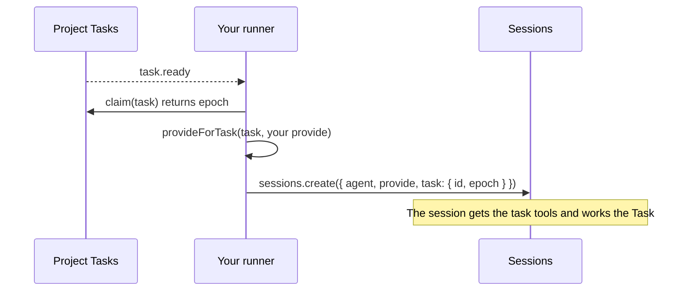

Final never starts a session for a Task by itself. A **runner** does: it claims a ready Task, decides what the Task's agent is provided, and starts a session bound to the claim. Final's apps run the Tasks people create in them. Your own runner can work any Task meant for it, on your infrastructure and with your credentials.



## Which runner works a Task

A root Task is created with `runner: 'caller'` or `runner: 'any'`:

- `'caller'` reserves it, and its steps, for the principal that created it. Only that principal can claim them; every other runner is refused with `not_runner`.
- `'any'` lets any runner in the project claim it.

Tasks proposed in Final's apps, and the steps their leads create, are reserved for Final's own runner. Create the roots your runner should work with `runner: 'caller'` from the runner's own API key, so the two never compete.

## Claim and bind

A claim is a lease on one Task. `claim` returns the Task and its **epoch**, which rises with every claim; `renew`, `release`, and a runner's holds name the epoch they hold, and a stale one is refused with `stale_epoch`.

```ts
const { task, epoch } = await project.tasks.claim({ taskId });
// Or the oldest ready Task that matches:
const next = await project.tasks.claimNext({ labels: { role: 'scanner' } });
```

A new claim must be bound to a session within two minutes. Call `renew({ taskId, epoch })` to keep it while you prepare, for example while a sandbox boots, or `release({ taskId, epoch })` to hand it back. A claim that's neither bound nor renewed in time is released, and the Task is ready again.

Bind the claim by starting the session with `task`:

```ts
await project.sessions.create({
  agent,
  provide: provideForTask({ task, provide: { harness: myHarness, integrations: { repo: github } } }),
  task: { id: task.id, epoch },
  message: task.brief,
});
```

The session's `idempotencyKey` defaults to `task:<id>:<epoch>`, so a retried create binds the same session. Final refuses the binding unless:

- you hold the claim, and its epoch is current;
- the agent is the one the Task names, when it names one;
- the session's `provide` agrees with every field the Task sets;
- the session is in the Task's project.

From then on, the session works the Task through its [task tools](/tasks/agent-tools). When the session closes or fails, its claim is released.

Sessions act for whoever creates them. A runner with a person's token starts sessions that act for that person. A runner with an API key starts sessions owned by its principal, with the principal's credentials and spending.

## Provide what the Task leaves out

A Task carries the `provide` keys its creator meant, usually the harness and its model, and leaves the rest to the runner. `provideForTask({ task, provide })` keeps every field the Task sets and fills the rest from yours:

- the harness's environment, inference, and other configuration, when you name the same harness;
- integration slots the Task doesn't set;
- compute, when the Task sets none.

There is no default model. A Task that sets no harness is the runner's to choose; Final's runner refuses to start one rather than pick a model for it. See [requirements and providing](/build/requirements).

## Write a runner

`createTaskRunner` claims the Tasks you match, keeps each claim renewed while `start` runs, and releases it if `start` fails:

```ts runner.ts
import { createClient, createTaskRunner, provideForTask } from '@finalai/agents/client';
import { finalCredits, serverlessPi } from '@finalai/agents/harnesses';
import { scanner } from './scanner.js';

const client = createClient({ auth: { apiKey: process.env.FINAL_API_KEY! }, localCompute: false });
const project = client.project({ id: process.env.FINAL_PROJECT_ID! });
const github = await project.integrations.get({ name: 'github' });

const runner = createTaskRunner({
  project,
  match: (task) => task.labels.role === 'scanner',
  start: async ({ task, binding }) => {
    await project.sessions.create({
      agent: scanner,
      provide: provideForTask({
        task,
        provide: {
          harness: serverlessPi({ model: 'gpt-6.1-sol', inference: finalCredits() }),
          integrations: { repo: github },
        },
      }),
      task: binding,
      message: task.brief,
    });
  },
  webhookSecret: process.env.FINAL_WEBHOOK_SECRET,
});
```

Then hear about ready Tasks one of two ways:

- **Push.** Subscribe a URL to `TASK_RUNNER_EVENT_KINDS` with `project.eventSubscriptions.create(...)` and answer it with `runner.handleWebhook(request)`. It verifies each delivery and answers once each matched Task was started or skipped, so keep `start` to creating the session.
- **Poll.** `await runner.poll({ signal })` claims what's ready now, then follows the [event feed](/operate/events).

Each claim is started once. Refusals are skipped, and after a cap or budget refusal, a freed slot sweeps the ready Tasks again. `onError` hears failed starts, claims, and renewals. The [`@finalai/agents` README](https://www.npmjs.com/package/@finalai/agents) lists every option.

## When a claim is refused

Claims are refused with a `409` and one of these codes:

| Code | Why |
| --- | --- |
| `cap_reached` | The project, or the Task's root, already runs as many claims as its cap allows. |
| `budget_exhausted` | The root has spent its budget. The person is asked to raise it. |
| `exclusive_busy` | Another claim holds the Task's exclusive key. |
| `not_runner` | The Task is reserved for another runner. |
| `not_ready` | The Task isn't `ready`: someone else claimed it, or it's waiting or finished. |
| `stale_epoch` | A renew, release, hold, or completion named an old epoch. |

None of these is an error worth retrying at once. Wait for the next `task.ready`, `task.released`, or a finished Task.

## Ask before you start

Sometimes a runner can't start a session yet: the acting person must sign in to an integration, or connect billing. Hold the Task instead of failing it:

```ts
await project.tasks.hold({ taskId, epoch, kind: 'requirement', body: 'Sign in to GitHub to start this Task.' });
```

The person gets the question in **Needs you**. While held, the claim doesn't expire. Once it's answered, the claim is released and the Task is ready again, without counting as a failed attempt.

## Work a Task without a session

An **external claimer** works a Task itself instead of starting a session for it, such as a coding agent on your laptop driving the API from a script. It claims, then turns the two-minute bind window into a lease of one to 30 minutes, and renews the lease while it works:

```ts
const { task, epoch } = await project.tasks.claim({ taskId });
await project.tasks.renew({ taskId, epoch, leaseSeconds: 600 });

// Work, renewing before the lease ends.
await project.tasks.post({ taskId, body: 'Reproduced the failure; fixing the retry loop.' });

await project.tasks.complete({
  taskId,
  epoch,
  artifacts: [{ kind: 'link', title: 'Pull request', url: 'https://github.com/acme/api/pull/412' }],
});
```

An external claimer posts updates, holds, requests review, and completes or fails with its `epoch`, like a session would with its task tools. If its lease lapses, the claim is released and the Task is ready for anyone else.
