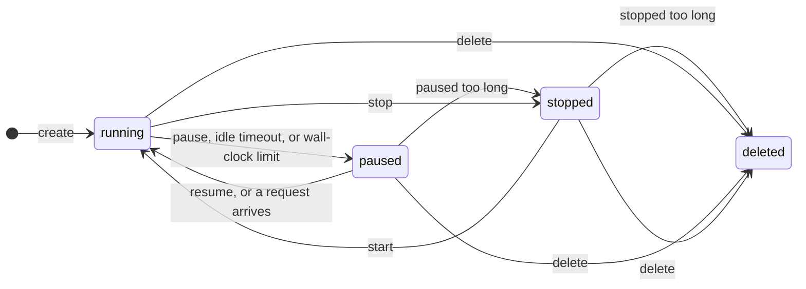

A VM doesn't have to run all the time. Pause it when nobody is using it and resume it later with its programs still running. Save a snapshot when it's in a state you want to reuse, like after a slow dependency install, and start new VMs from that point. Or fork it into several copies to try different things in parallel.

The examples use the `FINAL_API_KEY`, `FINAL_VM_API_URL`, and `SANDBOX_ID` variables from the [quickstart](/vm-platform/quickstart).

## Choose an operation

| You want to | Use | What's kept |
| --- | --- | --- |
| Step away and come back to exactly where you were | [Pause and resume](#pause-and-resume) | Disk, memory, and running programs |
| Shut the VM down and boot it again later | [Stop and start](#stop-and-start) | Disk only. The workload starts fresh. |
| Save a restore point to start new VMs from | [Checkpoint](#save-a-snapshot) | Disk and memory, as a snapshot |
| Run several copies side by side | [Fork](#fork-a-vm) | Each copy gets the original's disk and memory |
| Be done with it | [Delete](#delete-a-vm) | Nothing |

## How a VM moves between states



Between these settled states, a VM briefly passes through `creating`, `pausing`, `resuming`, `stopping`, `starting`, or `deleting`. A VM is `failed` if its machine stopped unexpectedly. Its disk is intact, and `start` boots it again.

## Pause and resume

```bash
curl -sS -X POST "$FINAL_VM_API_URL/sandboxes/$SANDBOX_ID/pause" \
  -H "Authorization: Bearer $FINAL_API_KEY" | jq '.sandbox.state'
```

Pausing freezes the VM and saves its memory and disk. To pick up where you left off:

```bash
curl -sS -X POST "$FINAL_VM_API_URL/sandboxes/$SANDBOX_ID/resume" \
  -H "Authorization: Bearer $FINAL_API_KEY" | jq '{state: .sandbox.state, resumed}'
```

```json
{ "state": "running", "resumed": { "mode": "memory" } }
```

`"mode": "memory"` means the VM continued exactly where it paused, with its programs still running. Sometimes the saved memory is no longer available, for example after a long pause. Then the response says `"mode": "cold"`: the VM booted from its saved disk and ran its workload again. Programs that were running need to restart, so check your service's health after a cold resume.

Open network connections don't survive a pause in either mode. Reconnect clients after you resume.

## Stop and start

Stop a VM when you want to keep its disk but don't need its memory:

```bash
curl -sS -X POST "$FINAL_VM_API_URL/sandboxes/$SANDBOX_ID/stop" \
  -H "Authorization: Bearer $FINAL_API_KEY" | jq '.sandbox.state'
```

`start` boots it again and runs the workload from the beginning:

```bash
curl -sS -X POST "$FINAL_VM_API_URL/sandboxes/$SANDBOX_ID/start" \
  -H "Authorization: Bearer $FINAL_API_KEY" | jq '.sandbox.state'
```

A stopped VM stays offline until you start it, even if requests arrive for its domain.

## What Final does automatically

Two timers pause a running VM for you, so a forgotten VM doesn't run forever:

- **Idle timeout** (`timers.idle_timeout_s`): pauses the VM when nothing has talked to it for this many seconds. Talking means file reads, requests to its ports, and dashboard sessions. A busy process with no visitors still counts as idle. Set it to `null` to turn it off.
- **Wall-clock limit** (`timers.wall_clock_limit_s`): pauses the VM after it has run for this many seconds, no matter how busy it is. The clock starts again each time the VM is created, resumed, or started.

If you don't set them, your organization's defaults apply. Each VM also has a lifetime after it stops running:

- A VM that stays paused for a long time is stopped, which frees its memory. A resume after that is a cold resume.
- A VM that stays stopped for a long time is deleted.

Read the sandbox to see exactly when each of these will happen. The times are in Unix milliseconds:

```bash
curl -sS "$FINAL_VM_API_URL/sandboxes/$SANDBOX_ID" \
  -H "Authorization: Bearer $FINAL_API_KEY" \
  | jq '{state, timers, wall_clock_deadline_at, paused_until, deletes_at}'
```

| Field | Meaning |
| --- | --- |
| `wall_clock_deadline_at` | When a running VM will be paused by its wall-clock limit. |
| `paused_until` | When a paused VM will be stopped. |
| `deletes_at` | When the VM will be deleted. |
| `warn_at` | When Final starts warning that deletion is coming. |
| `hard_ttl_at` | When the VM's `ttl_s` lifetime runs out. |

### Extend a running VM

Give a VM more time by setting a new wall-clock limit. The new limit counts from now:

```bash
curl -sS -X POST "$FINAL_VM_API_URL/sandboxes/$SANDBOX_ID/timeout" \
  -H "Authorization: Bearer $FINAL_API_KEY" \
  -H "Content-Type: application/json" \
  -d '{"wall_clock_limit_s": 3600}' \
  | jq '.sandbox | {state, wall_clock_deadline_at}'
```

Your plan sets the longest limit you can ask for.

### Other automatic behavior

<AccordionGroup>
  <Accordion title="Wake on request (auto_resume)">
    By default, a paused VM resumes by itself when a request reaches it through a published port or custom domain. Set `"auto_resume": false` at creation to keep it paused until you call `resume`.
  </Accordion>
  <Accordion title="Delete when idle (ephemeral)">
    Set `"ephemeral": true` at creation to delete the VM when its idle timeout fires, instead of pausing it. Use this for throwaway VMs whose results you read before they go idle.
  </Accordion>
  <Accordion title="Hard lifetime (ttl_s)">
    Set `ttl_s` at creation to delete the VM that many seconds after it's created, whatever state it's in. Use it as a backstop when your own cleanup code might not run.
  </Accordion>
</AccordionGroup>

## Save a snapshot

A checkpoint saves the VM's disk and memory as a snapshot. The VM keeps running; it's frozen only for a moment while the snapshot is taken.

```bash
export SNAPSHOT_ID=$(curl -sS -X POST "$FINAL_VM_API_URL/sandboxes/$SANDBOX_ID/checkpoint" \
  -H "Authorization: Bearer $FINAL_API_KEY" \
  -H "Content-Type: application/json" \
  -d '{"name": "acme-web-deps-installed"}' | jq -r '.snapshot_id')
```

The `name` is optional but worth setting. Only named snapshots appear in `GET /snapshots`, and names must be unique. It also makes retries safe: if your request times out and you send it again, you get `name_taken` instead of a second snapshot.

The snapshot is ready to use once its `durable_at` is set:

```bash
curl -sS "$FINAL_VM_API_URL/snapshots/$SNAPSHOT_ID" \
  -H "Authorization: Bearer $FINAL_API_KEY" | jq '{id, name, durable_at}'
```

<Warning>
A snapshot captures the VM as it is at that moment. If a database or another program is in the middle of writing, flush or stop it first so the snapshot holds a consistent copy.
</Warning>

### Start a VM from a snapshot

Pass the snapshot as the `source` when you create a VM:

```bash
curl -sS "$FINAL_VM_API_URL/sandboxes" \
  -H "Authorization: Bearer $FINAL_API_KEY" \
  -H "Content-Type: application/json" \
  -d "{\"source\": {\"kind\": \"snapshot\", \"snapshot_id\": \"$SNAPSHOT_ID\"}, \"labels\": {\"name\": \"acme-web-pr-142\"}}" \
  | jq '.sandbox | {id, state}'
```

The new VM resumes from the snapshot's memory, so programs that were running keep running. It gets the same vCPU and memory size as the original. You can ask for a larger disk, but not a smaller one.

If you include a `workload` in the request, Final boots from the snapshot's disk instead and runs your new command, without restoring memory.

## Fork a VM

Forking makes running copies of a VM in one call. Each copy is an independent VM that starts from the original's current memory and disk, and the original keeps running.

```bash
curl -sS -X POST "$FINAL_VM_API_URL/sandboxes/$SANDBOX_ID/fork" \
  -H "Authorization: Bearer $FINAL_API_KEY" \
  -H "Content-Type: application/json" \
  -d '{"count": 3}' \
  | jq '{snapshot_id, children: [.children[] | {id, state}]}'
```

```json
{
  "snapshot_id": "snp_3kR8vQ2nW5xT9mLp4sHd7B",
  "children": [
    { "id": "sbx_9Lm4nP2qR7sT5vW8xY3zA1", "state": "running" },
    { "id": "sbx_2Bc5dE8fG1hJ4kL7mN9pQ3", "state": "running" },
    { "id": "sbx_6Rs8tU1vW4xY7zA2bC5dE9", "state": "running" }
  ]
}
```

You can fork up to 16 copies at once from a running or paused VM. Keep the child IDs: each copy is a separate VM that you pause and delete on its own.

## Delete a VM

```bash
curl -sS -X DELETE "$FINAL_VM_API_URL/sandboxes/$SANDBOX_ID" \
  -H "Authorization: Bearer $FINAL_API_KEY" | jq '.sandbox.state'
```

Deleting removes the VM and its disk. Snapshots you saved from it stay until you delete them with `DELETE /snapshots/{id}`. Deleting a snapshot that's still in use, for example by a template, returns `snapshot_in_use`.

## Related

<Columns cols={2}>
  <Card title="Templates" icon="layer-group" href="/vm-platform/images-and-templates#prepare-a-template">
    Build a ready-to-run environment once and start every VM from it.
  </Card>
  <Card title="Volumes" icon="hard-drive" href="/vm-platform/files-and-volumes#keep-data-in-a-volume">
    Keep data that outlives any one VM.
  </Card>
</Columns>
